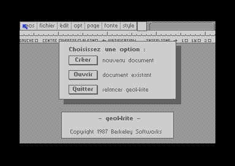
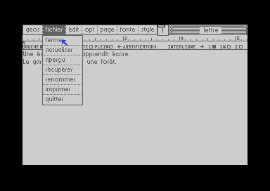
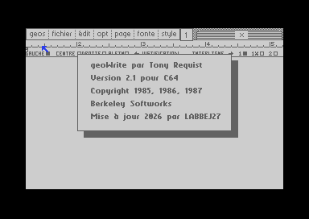

# geoWrite FR

**geoWrite 2.1 en français, sur une cartouche qui démarre d'un coup** : GEOS, le traitement de texte, la souris et le pilote d'imprimante Commodore MPS-803 tiennent dans un seul fichier `.crt`. Tes documents restent sur une disquette (ou une image `.d64`).



## Ce que ça apporte

- **Démarrage direct dans geoWrite** depuis une cartouche EasyFlash, sans deskTop ni disquette système.
- **Tout en français** : menus, messages, boutons, règle.
- **Accents à l'écran, dans les documents et à l'impression** : é è à ç ê ù ô î.
- **Souris 1351** sur le port 1 (la souris USB du C64 Ultimate est vue comme une 1351).
- **Pilote Commodore MPS-803 / MPS-801** en mode graphique : tout ce qui est à l'écran s'imprime, polices comprises.
- **Impression d'un simple message** : le papier s'arrête juste après la dernière ligne pour pouvoir déchirer. Un document de plusieurs pages garde ses sauts de page.

| Menu fichier | À propos |
|---|---|
|  |  |

## Utilisation

1. Copie [`dist/geowrite-fr.crt`](dist/geowrite-fr.crt) sur ta carte SD.
2. Monte une image `.d64` formatée GEOS sur le lecteur 8 : ce sera ton disque de documents. `make geowrite` en crée une vierge dans `geowrite/build/documents.d64`.
3. Lance la cartouche.

Sans disque sur le lecteur 8, geoWrite affiche « Insérez un disque de documents GEOS. ».

### Taper les accents

| Accent | Touches |
|---|---|
| é | `C=` + `:` |
| è | `C=` + `↑` |
| à | `C=` + `;` |
| ç | `C=` + `*` |
| ô | `C=` + `/` |
| ê | `Shift` + `:` |
| ù | `Shift` + `;` |
| î | `↑` |

En échange, les symboles `{ | } ~ [ ] \ ^` ne sont plus disponibles dans la police système.

### Imprimer

Imprimante sur le bus série, **périphérique 4**. Choisis le mode **Haute** dans la boîte d'impression : le mode Rapide utilise les caractères de l'imprimante, qui n'a pas les accents.

## Matériel testé

| Configuration | État |
|---|---|
| C64 Ultimate Founders Edition, firmware 1.1.0, à 1 MHz | Testé : souris USB, création, enregistrement, impression sur MPS-803 |
| Même machine avec turbo 64 MHz, JiffyDOS et REU | Création et enregistrement testés ; souris et impression pas encore vérifiées |
| VICE 3.10 (cartouche EasyFlash, 1541, MPS-803 émulés) | Testé, sert de banc d'essai automatique |
| C64 d'origine avec Kung Fu Flash 2 | **Pas encore testé** |

Sur un C64 d'origine, il faut une vraie souris 1351 (ou un adaptateur) et un vrai lecteur 1541 pour les documents : GEOS pilote le lecteur directement, ce que l'émulation de disque de Kung Fu Flash ne gère pas.

## Compiler

Outils : `make`, `python3`, [cc65](https://github.com/cc65/cc65) et [VICE](https://vice-emu.sourceforge.io) (pour `c1541` et les tests). Sur macOS :

```sh
brew install cc65 vice
make geowrite
```

Au premier build, `tools/setup-vendor.sh` clone les sources de [mist64/geos](https://github.com/mist64/geos) et [mist64/geowrite](https://github.com/mist64/geowrite) à la version testée, puis applique les modifications de [`patches/`](patches). Le résultat est dans `geowrite/build/geowrite.crt`.

### Avec un C64 Ultimate sur le réseau

`C64_IP` vaut `192.168.1.128` par défaut ; change-le en ligne de commande si besoin.

```sh
make geowrite-run C64_IP=192.168.1.128   # installe dans /SD/geowrite, monte documents.d64 et lance
make stock                               # passe la machine en configuration d'origine (sauvegarde tes réglages)
make restore                             # remet tes réglages
```

`geowrite-run` n'écrase jamais `documents.d64` : il en garde une copie dans `documents/sauvegardes/` à chaque lancement.

## Comment ça marche

- **Cartouche** ([`geowrite/crt.s`](geowrite/crt.s), [`tools/mkcrt.py`](tools/mkcrt.py)) : la banque 0 démarre, recopie le noyau GEOS en mémoire et laisse une petite routine de lecture en `$0340`.
- **Disque virtuel** : geoWrite et le pilote d'imprimante sont rangés comme des fichiers GEOS sur une piste 36 qui n'existe pas. Le pilote 1541 lit cette piste dans la cartouche, et son répertoire s'ajoute à celui de la vraie disquette. geoWrite lui-même n'a donc presque pas changé.
- **Pilote MPS-803** ([`geowrite/mps803.s`](geowrite/mps803.s)) : regroupe les rangées de 8 points de GEOS en passes de tête de 7 aiguilles, 480 points par ligne.
- **Traduction** ([`tools/mkfr.py`](tools/mkfr.py)) : table de correspondances qui vérifie que chaque texte existe et tient dans sa boîte. Les boutons et la règle sont redessinés par [`tools/mkicons.py`](tools/mkicons.py), la police par [`tools/mkfont.py`](tools/mkfont.py).
- **Tests** ([`tests/print/vicesim.py`](tests/print/vicesim.py)) : pilote geoWrite dans VICE par clics et frappes simulés, avec impression sur la MPS-803 émulée.

## Crédits

- **GEOS et geoWrite** : Berkeley Softworks ; geoWrite par Tony Requist.
- **Sources rétro-conçues** : Michael Steil et Maciej Witkowiak ([mist64/geos](https://github.com/mist64/geos), [mist64/geowrite](https://github.com/mist64/geowrite)).
- **Mise à jour 2026** : LABBEJ27, avec Claude.

## Droits

GEOS et geoWrite restent l'œuvre de Berkeley Softworks ; les dépôts de mist64 ne portent pas de licence. Ce projet est un travail d'amateur, sans but commercial. Si tu détiens des droits sur ces logiciels et que cette publication te pose problème, ouvre une issue et elle sera retirée.

---

*English: a French, single-cartridge build of GEOS 2.0 + geoWrite 2.1 for the Commodore 64 (EasyFlash `.crt`), with 1351 mouse support and a Commodore MPS-803 printer driver. Documents are stored on drive 8. Build with `make geowrite`.*
